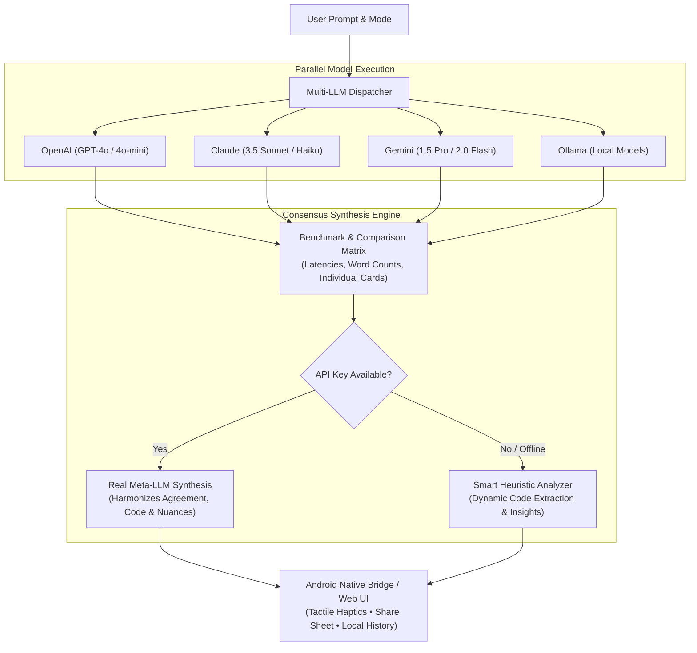

# PolyMind AI - Multi-LLM Orchestrator & Consensus Engine 🧠⚡

> **PolyMind AI** is an advanced AI Orchestrator that queries **ChatGPT (OpenAI)**, **Claude (Anthropic)**, **Gemini (Google)**, and **Ollama (Local LLM)** in parallel, compares their outputs side-by-side with real-time latency benchmarks, and synthesizes an authoritative unified consensus master response.

Available as a modern responsive web application and native Android app with hardware acceleration, tactile haptics, and system sharing.

---

## 🌟 Key Features

- ⚡ **Parallel Multi-Model Execution**: Dispatch a single prompt simultaneously to ChatGPT (GPT-4o / GPT-4o-mini), Claude (3.5 Sonnet / 3.5 Haiku), Gemini (1.5 Pro / 2.0 Flash), and Ollama (Local LLM).
- 🎯 **Dynamic AI Consensus Engine**:
  - **Meta-LLM Synthesis**: Uses active API models to dynamically synthesize points of agreement, divergences, and harmonized code solutions.
  - **Smart Heuristic Fallback**: Intelligent client-side heuristic engine that extracts code blocks and key stances when offline or in simulation mode.
- 🎛️ **4 Specialized Orchestration Modes**:
  - **🎯 Consensus**: Synthesizes universal agreements and a unified master solution.
  - **⚔️ Code Battle**: Pits models against each other for the cleanest, most performant, and memory-efficient implementation.
  - **🔍 Fact-Check**: Exposes hallucinations, contradictions, and data discrepancies.
  - **⚖️ Debate & Perspectives**: Compares contrasting trade-offs, paradigms, and design philosophies.
- ⏱️ **Real-Time Latency & Word Benchmarking**: Live timer display (`⚡ 540ms`) and word counts on every model card.
- 🦙 **Ollama Auto-Discovery**: One-click local model detector that queries `http://localhost:11434/api/tags` and populates installed models (DeepSeek-R1, Mistral, Llama 3.2, Qwen2.5-Coder).
- 📱 **Native Android Bridge & Tactile Haptics**:
  - Tactile vibration feedback on button presses and consensus completion (`AndroidBridge.vibrate`).
  - Native Android sharing sheet (`AndroidBridge.shareConsensus`) to forward results to Slack, WhatsApp, X, or email.
  - Dedicated clipboard copy bridge (`AndroidBridge.copyToClipboard`).
- 📜 **Local Orchestration History & Export**:
  - Automatic persistence of past runs in private device storage with search and filtering.
  - Export consensus as Markdown (`.md`) or full history as JSON.
- 🔐 **Privacy-First Client-Side Keys**: API keys never touch any intermediary backend; they reside entirely in client-side secure storage.
- 💡 **Zero-Setup Simulation Mode**: Runs complete dynamic simulations out-of-the-box if no API keys are provided.

---

## 🏗️ Architecture



---

## 🚀 Getting Started

### Web Application

1. Clone the repository:
   ```bash
   git clone https://github.com/apravint/polymind-ai.git
   cd polymind-ai
   ```
2. Open [`web/index.html`](web/index.html) in any modern web browser or serve via a local HTTP server:
   ```bash
   python3 -m http.server 8080 --directory web
   ```
3. Open `http://localhost:8080`.
4. (Optional) Click **Config** in the header to enter your OpenAI, Anthropic, or Google Gemini API keys, or connect to your local Ollama instance.

### Android Application (`PolyMind.apk`)

The native Android app wraps the orchestrator within a high-performance hardware-accelerated WebView connected to Java-level system services.

- **Automated CI/CD**: Compiled via GitHub Actions using Android SDK Build-Tools 34, AAPT, D8 DEX compiler, 4-byte ZipAlignment, and V1/V2/V3 APK signing.
- Download the precompiled APK from [GitHub Releases](https://github.com/apravint/polymind-ai/releases).

---

## ⚙️ Ollama Local LLM Setup

To use PolyMind with local models without cloud API costs:
1. Ensure Ollama is installed and running:
   ```bash
   ollama run llama3.2
   ```
2. For browser access, permit web origins by starting Ollama with:
   ```bash
   OLLAMA_ORIGINS="*" ollama serve
   ```
3. In PolyMind, click **Config** > **Auto-Detect Installed Ollama Models** to load your installed models automatically.

---

## 📄 License

Created by **Ayyappa Pravin** ([@apravint](https://github.com/apravint)). Open source under the MIT License.
